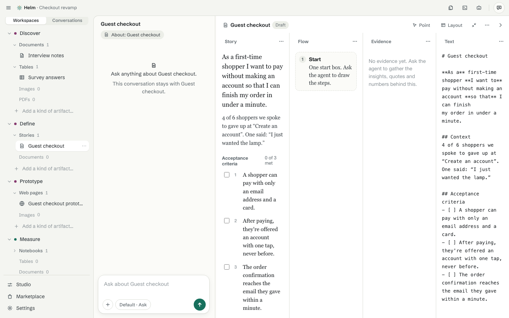
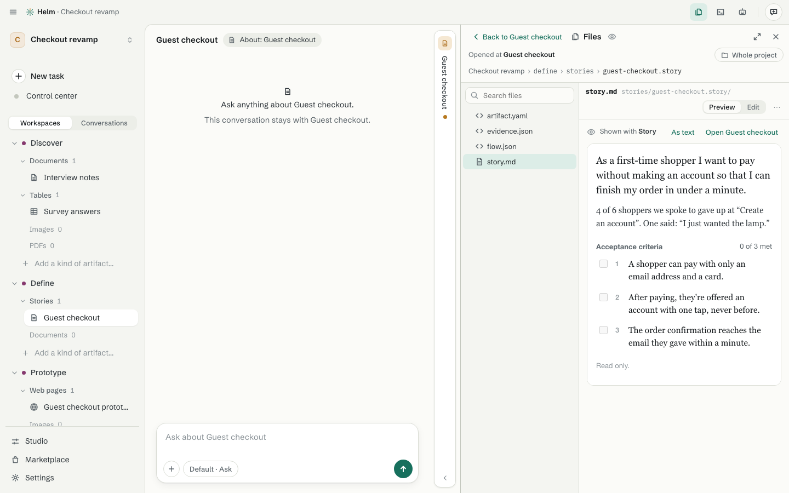

# Artifacts

[Guide](README.md) · previous: [Workbenches and capabilities](workbenches-and-capabilities.md) · next: [Working with the agent](working-with-the-agent.md)

An **artifact** is the thing you're working on: a user story, a web page, an interview, a ticket. It's a folder that Helm shows as one thing, and it's what you open, rename, move, duplicate and share.

## Open one

Click an artifact in the sidebar. It opens on the right, in the faces of its workbench (for a story: Story, Flow, Evidence and Text). You can edit it directly, or ask the agent in the conversation on the left.

## Ask and Work

Two postures, one window. **Ask** puts the conversation in the middle with the artifact beside it. **Work** gives the artifact the room and narrows the conversation to the side. Opening an artifact from the sidebar starts in Work. Change either any time with **Expand**, or set the starting posture in Settings.

## Point at a part

Click **Point** in the artifact's header, then click a part, such as a criterion, a step in a flow, or a row of a table. It becomes a chip above the message box (*Criterion 2 of Guest checkout*), and the agent changes exactly that part. A part the agent changed is marked *edited by agent*. Other ways of pointing are offered when the artifact supports them: several parts, a drawn box, selected text, a stretch of time in a recording, or a spot on a page.

## Everyday things

- **New / rename / move / duplicate / remove** from the sidebar's **⋯** on the artifact. Remove shows what it affects first, and waits 30 days in **Recently removed**.
- **×** on the artifact's header folds it to a slim rail on the right; click the rail to bring it back. Closing it for real is the last item in its **⋯**.
- **Files:** the artifact's own files are ordinary files. **Show in Files** opens them in the Files pane.
- **Versions:** an artifact keeps its drafts and versions, so you can go back.

## The Files pane

The **Files** button (top right, or Control Shift E) opens a pane at the folder of wherever you are, with a tree on the left and the file on the right. **Preview** shows a document nicely, **Edit** changes the source, and **Changes** shows what the agent changed, with Undo for each file.

