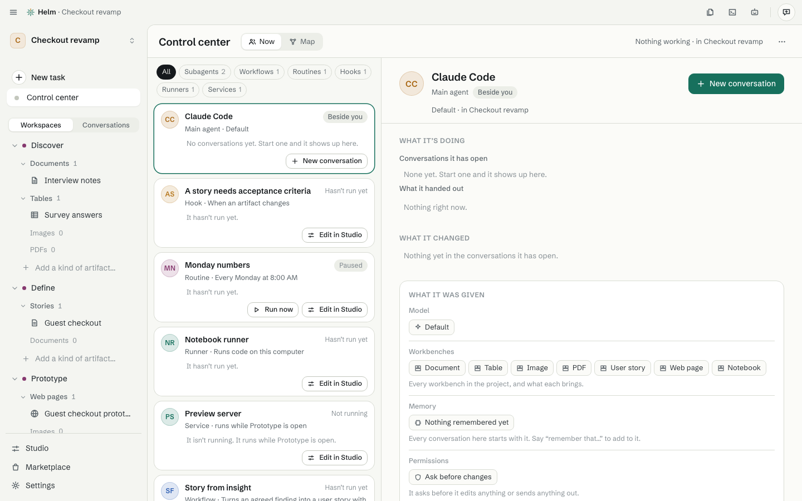
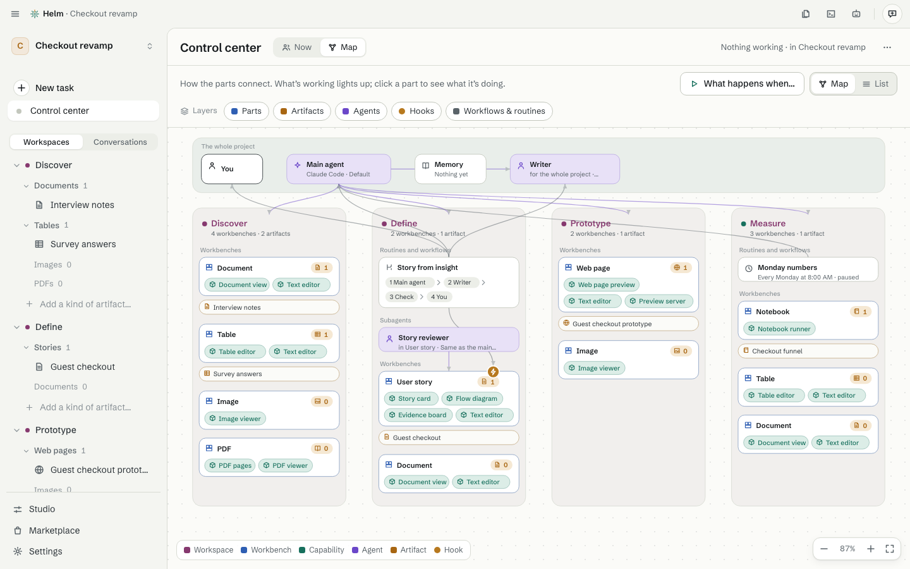

# The Control center

[Guide](README.md) · previous: [The Marketplace](marketplace.md) · next: [Workflows and routines](workflows-and-routines.md)

The Control center shows **who is working on what**, like watching colleagues work instead of reading a log. Click **Control center** at the top of the sidebar. The sidebar line under it says how many are working and how many are waiting for you.

## Now

One card for each thing that works: the main agent (beside you), each subagent, workflow, routine, hook and runner your project uses, even ones that haven't run yet. A card shows its name and state (*Working*, *Waiting for you*, *Next Tomorrow 07:00*, *Paused*, *Last ran 10:12*, *Hasn't run yet*), what it's for in one line, its last three runs, and its buttons:

- **Answer**: a run waits for you.
- **Stop**: a run is working.
- **Run now**: for workflows and routines.
- **New conversation** (the main agent) and **Talk to it** (a subagent).
- **Edit in Studio**: that part's own page.

Cards come in this order: working now, waiting for you, scheduled next, then by last activity. Filters on top (All, Subagents, Workflows, Routines, Hooks, Runners) show only the kinds your project has.

Click a card for its detail on the right: what it's doing, a live transcript, **What it was given** (instructions, tools, permissions, model), and **What it changed** (a sentence such as "Changed Checkout funnel: 6 lines added, 5 taken out", with the lines one click away).

## Map

The second tab, **Map**, draws how the project is set up and how work flows through it: a band for the whole project, then a column for each workspace, with its workbenches, capabilities, helpers and artifacts. What's working lights up green, and what's waiting for you lights up amber. Click a part for what it's doing now; use **What happens when…** to light up a path (a new recording arrives, you run a workflow). On a small window the map is a list.

## When a routine skips something

A routine never waits for you in the middle of a run, because you may be away. A step that needed a yes shows as **Skipped while you were away**, with **Allow this from now on** if you want it to go ahead next time.
