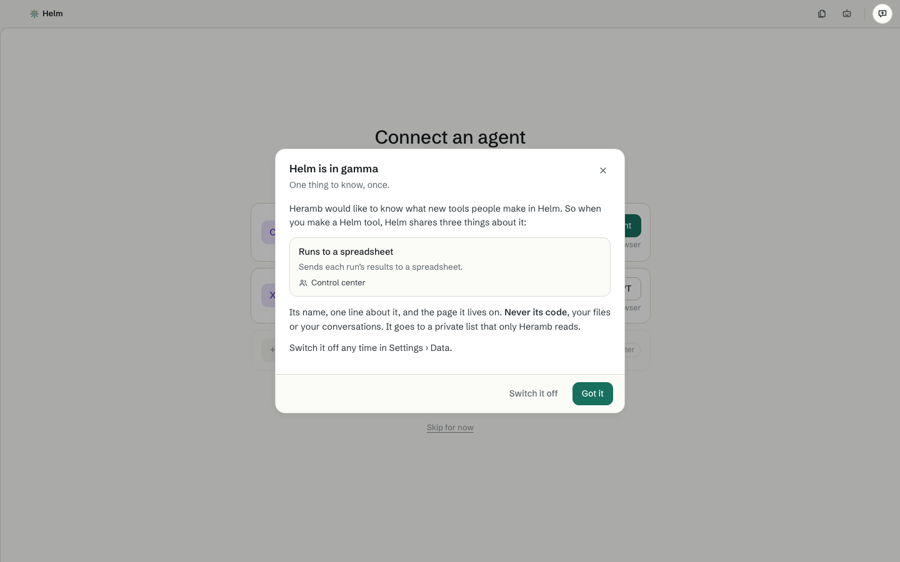
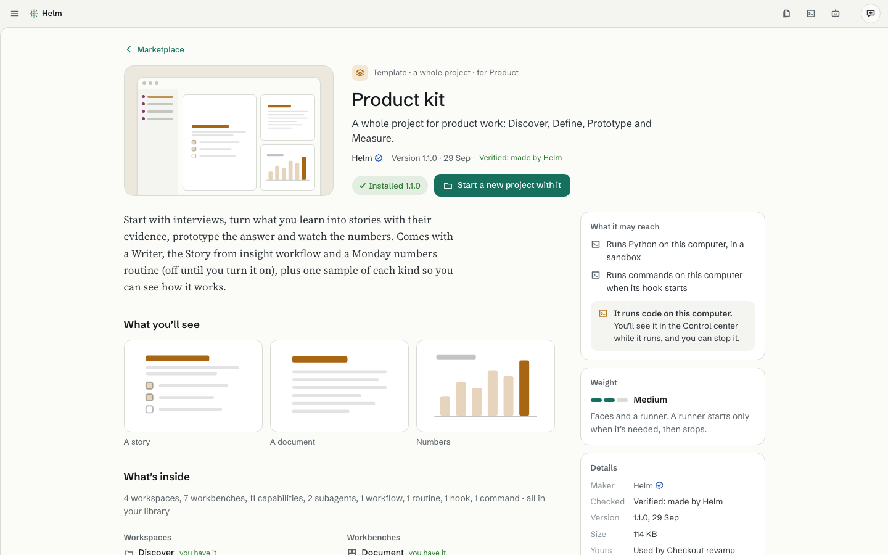
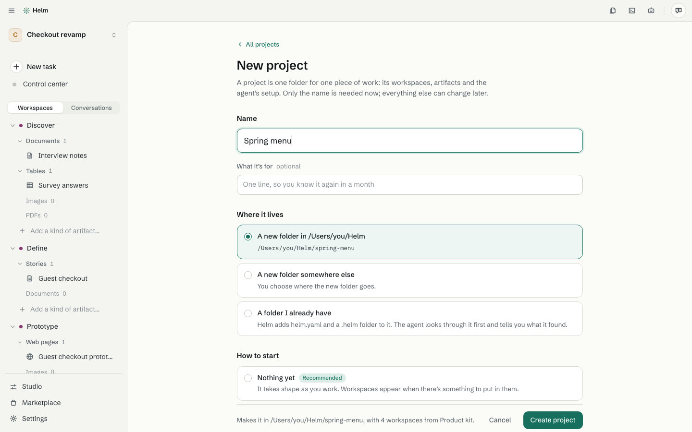
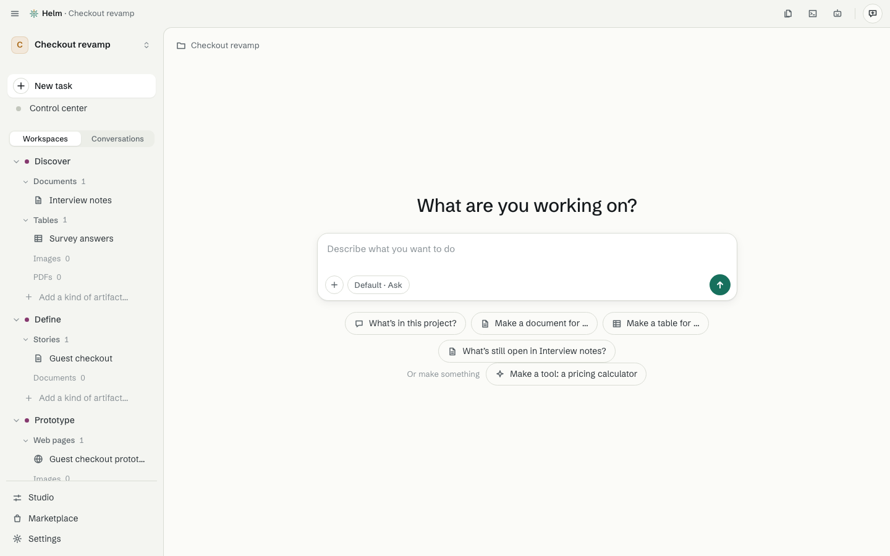

# Get started

[Guide](README.md) · next: [Projects](projects.md)

You've [installed Helm](../../README.md#install). Here is the first ten minutes.

## 1. Sign in to an agent

The first time Helm opens, it asks you to **Connect an agent**. Pick **Claude Code** (sign in with your Claude
account) or **Codex** (sign in with ChatGPT). Your browser opens, you sign in, and you're back in Helm. You need
an account with that company; Helm doesn't provide one. You can sign in to the other one later, in
**Settings › Agents**. More in [Sign in or switch accounts](../help/sign-in.md).

If you click **Skip for now**, Helm opens but can't answer until you sign in.

The first time, Helm also shows a short note, **Helm is in gamma**: what is shared with Heramb (a Helm tool's name and one line, never code or files) and how to switch it off. Press **Got it**.

## 2. Know what an empty project looks like

A new project starts **empty**. Helm doesn't come with ready-made workspaces or workbenches. You get them
from the Marketplace, or make your own in the Studio. That keeps Helm calm: you only see what you chose.
Where the sidebar would list workspaces, it says **No workspaces yet** with two links:
**Get from the Marketplace** and **Make your own in the Studio**.

## 3. Make your first project from a template

A **template** is a whole project already set up for a kind of work. The easiest way to see Helm properly is to start from one.

1. Click **Marketplace** at the bottom of the sidebar.
2. Open **Product kit** (a template for product work: Discover, Define, Prototype and Measure).

   

3. Read **What it may reach**, then click **Get** and **Allow and install**. Helm tells you plainly if
   something runs code on your computer or reaches the internet, and asks before it does.
4. Click **Start a new project with it**, give the project a name (for example *Checkout revamp*), and click
   **Create project**.

   

Your project opens with four workspaces in the sidebar and one example of each kind of artifact to look at.

## 4. Look around

- Click an artifact in the sidebar, such as **Guest checkout**, to open it on the right. See [Artifacts](artifacts.md).
- Click a workspace, such as **Define**, to see its page. See [Workspaces](workspaces.md).
- Type in the box at the bottom to ask the agent for something. See [Working with the agent](working-with-the-agent.md).
- The three buttons at the top right open **Files**, **Terminal** and the **Agent** pane.
- The round button at the far right is for [your notes](../help/report-a-problem.md).

## Starting with nothing instead

Choose **New project** in the project menu (top of the sidebar), pick **Nothing yet**, and say what you're working on
(for example *Plan a spring menu for the café*). Helm adds a plain workspace as the work needs it, and tells you, with **Undo**.
