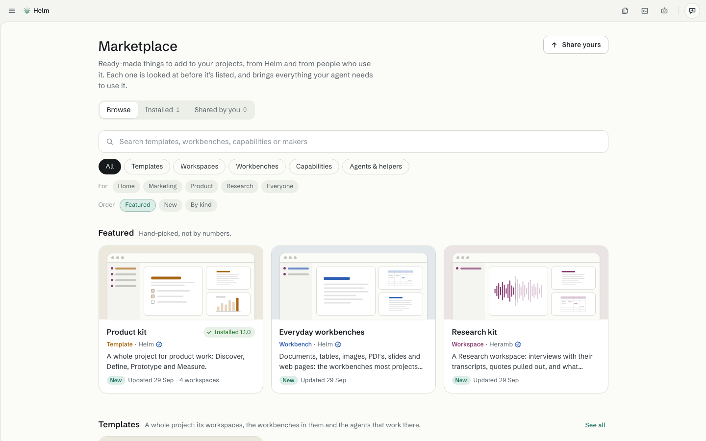

# The Marketplace

[Guide](README.md) · previous: [The Studio](studio.md) · next: [The Control center](control-center.md)

The Marketplace is where you get **templates, workspaces, workbenches, capabilities, and helpers** (subagents, workflows, hooks) that others made, and where you share your own. Click **Marketplace** at the bottom of the sidebar.

## Browse

Search, filter by kind (Templates, Workspaces, Workbenches, Capabilities, Agents & helpers) and by who it's for (Home, Marketing, Product, Research, Everyone). **Installed** lists what you have, with updates first. **Shared by you** lists what you sent in.

A **tick** beside the maker means Heramb made it or Helm made it. Other makers say plainly that Helm hasn't checked their item. There are no stars, reviews or install counts yet.

## Get something

Open an item. Its page shows what it is, a preview, **What's inside** (each part marked *you have it* or *new*), **What it may reach**, and its **weight**. Then:

1. Click **Get**. Helm shows what it may reach, and says plainly if it runs code or reaches the internet. Anything beyond that, Helm asks you first.
2. Click **Allow and install**.
3. The next step depends on the kind: a **template** starts a new project; a **workspace** is added to the project you have open; a **workbench** goes into a workspace; a **capability** goes into your library or a workbench; a **set** (a package of several workbenches) goes into your library, and you add them to a workspace from **Add a kind of artifact…**.

Step by step: [Get something from the Marketplace](../help/get-from-marketplace.md).

## What Helm puts in it

**Product kit** (a template: Discover, Define, Prototype and Measure), **Everyday workbenches** (Document, Table, Image, PDF, Slides, Web page), **Data and media workbenches** (Notebook, Dashboard, Recording, Video), **Research kit** (a workspace), and a few small helpers. The list is in the [marketplace folder](../../marketplace/README.md).

## Share yours

Click **Share yours**, pick something you made, and Helm runs checks in plain words: files well formed, what it may reach, samples open, nothing secret inside. You see a preview of the listing, then **Ready to send**: Helm makes one package file. You send it by opening a ready-made page on GitHub (you need a free GitHub account) and attaching the file. **Heramb checks each one and lists it.** Step by step: [Share something to the Marketplace](../help/share-to-marketplace.md).

## Where the list lives

Helm reads the list from this GitHub page. With no internet, it uses the last copy it fetched, and then the list built into the app.
