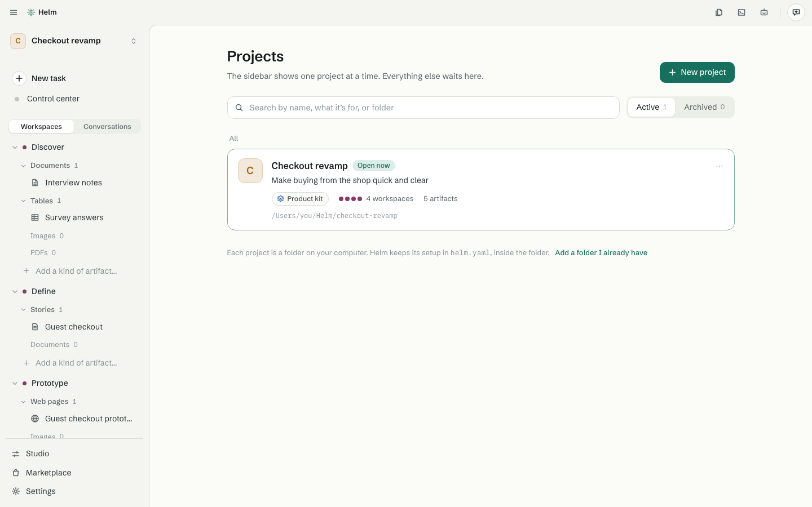

# Projects

[Guide](README.md) · previous: [Get started](getting-started.md) · next: [Workspaces](workspaces.md)

A **project** is one folder on your computer for one piece of work: its workspaces, its artifacts and the
agent's setup. The sidebar shows one project at a time.

## Make a project

Use **New project** (in the project menu at the top of the sidebar, or press ⌘ N on a Mac and Ctrl N on Windows and Linux). Only the name is needed.

- **Where it lives:** a new folder in your **Helm** folder (the default), a new folder somewhere else, or a folder you already have. For a folder you already have, Helm adds a `helm.yaml` file and a `.helm` folder, and the agent looks through it and tells you what it found.
- **How to start:** **Nothing yet** (recommended), a **template** from the Marketplace, or a copy of another project's setup.
- **The agent and how much it does on its own:** see [Working with the agent](working-with-the-agent.md).

## Switch between projects

Click the project name at the top of the sidebar. The menu lists pinned projects, then recent ones (with
*2 working* or *1 waiting* when agents are busy), then **All projects** (⌘ O or Ctrl O) and **New project**.
Switching takes you back to where you were in that project.

## All projects

Search, **Active** and **Archived**, pinned first. Each project shows what it's for, its template, how many workspaces and artifacts it has, who is working, and its folder. The **⋯** on a project has Open, Pin, Rename, Show in {Finder, File Explorer or your file manager}, Project settings, Archive and **Remove from Helm**. Removing from Helm leaves the folder and its files where they are.

## Project settings

Inside **Settings**, the open project has its own group: General, Workspaces (their order), Memory, Permissions, Routines and hooks, This project uses, **Use outside Helm**, Recently removed, and Archive or remove.

- **Memory** is what the agent remembers about the project, one line per instruction. Say "remember that…" in a conversation to add one.
- **Use outside Helm** gives you one line to paste into Claude Code or Codex elsewhere, so they know this project's setup too.

## It's just a folder

You can open a project's folder in your file manager. Each workspace is a folder, and each artifact is a folder inside it. To move a project to another computer, see [Move projects to a new computer](../help/move-projects.md).
