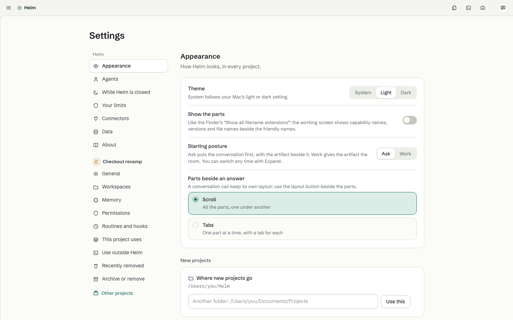

# Settings

[Guide](README.md) · previous: [Workflows and routines](workflows-and-routines.md) · next: [Keyboard shortcuts](shortcuts.md)

Click **Settings** at the bottom of the sidebar. Its pages are on the left; the open project's own settings are their own group below.

| Page | What's in it |
|---|---|
| **Appearance** | Theme (System, Light, Dark), **Show the parts** (names and file types beside the friendly names), the starting posture (Ask or Work), how parts show beside an answer (Scroll or Tabs), and **where new projects go** |
| **Agents** | Claude Code and Codex: who you're signed in as, your plan, how much of your 5-hour and weekly limit is used and when it resets, the **model** and **effort** new conversations start on, and the default agent. **For making things** is the Studio's agent (Opus · High by default). Other agents come later |
| **While Helm is closed** | Keep running routines in the menu bar (notification area, tray), open Helm when your computer starts, and when to tell you about a routine |
| **Your limits** | Plain sentences about what agents may never do, enforced everywhere, even in Auto |
| **Connectors** | Points to the Studio's Tools & connectors |
| **Data** | How long things are kept: conversations (until you remove them, or 90 or 30 days; pinned ones are always kept), file snapshots for Rewind (30 days), Recently removed (30 days), runs (90 days). The **Gamma** group has **Share the Helm tools you make with Heramb** (on by default) and **Send my notes…** |
| **About** | Helm's version |

Project settings (General, Workspaces, Memory, Permissions, Routines and hooks, This project uses, Use outside Helm, Recently removed, Archive or remove) are described in [Projects](projects.md).

## Common changes

- Change where **new** projects go: **Appearance › New projects**. Projects you already have stay where they are.
- Switch an agent's account: [Sign in or switch accounts](../help/sign-in.md).
- Change what's shared with Heramb: **Data › Gamma**.
