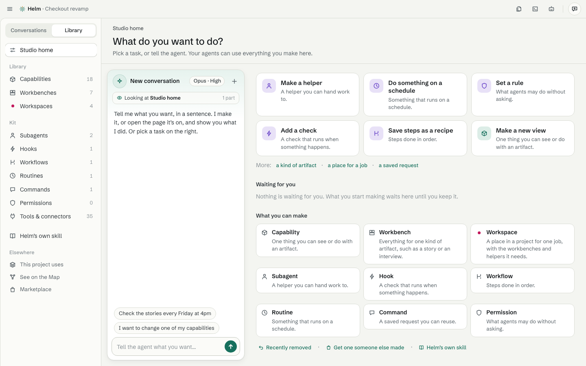

# The Studio

[Guide](README.md) · previous: [Working with the agent](working-with-the-agent.md) · next: [The Marketplace](marketplace.md)

The Studio is where you **make your own** capabilities, workbenches and workspaces, and the helpers around them. Click **Studio** at the bottom of the sidebar.

## How it works

The Studio has its own agent on every page. It knows which page you're on.

1. **Say what you want** in a sentence: "a calculator that keeps a tape of past results", or pick a task on the right.
2. **The agent makes it** and the face appears live on a sample within a minute.
3. **Use it.** Point at a part and say what to change, and it redraws. Every change is kept.
4. **Checks run by themselves** (files well formed, what it may reach, samples open). They show as a status and never stop you from carrying on.
5. **Add to my library** keeps it. Workbenches can then use it.

Undo works per request: five requests are five Undos back, and five Redos forward.

## What you can make

| Kind | In one line |
|---|---|
| Capability | One thing you can see or do with an artifact |
| Workbench | Everything for one kind of artifact |
| Workspace | A place in a project for one job |
| Subagent | A helper you can hand work to |
| Routine | Something that runs on a schedule |
| Hook | A check that runs when something happens |
| Workflow | Steps done in order |
| Command | A saved request you can reuse |
| Permission | What agents may do without asking |

Each kit page asks only a few things (four at most), has an **ⓘ** beside every field, and has a **Try** panel where you can run it and see the result.

## The library

The Studio's sidebar has **Library** (Studio home, Capabilities, Workbenches, Workspaces, and the kit: Subagents, Hooks, Workflows, Routines, Commands, Permissions, **Tools & connectors**) and **Conversations** (every conversation you've had with the Studio's agent).

A list shows **Yours** first, then **Installed from the Marketplace**, then **Built into Helm** (capabilities only; those can't be removed).

## Making a change to something you installed

Parts you installed are read only until you click **Make it mine**, which makes your own copy to change.

## Tools and connectors

**Tools & connectors** is the one place for everything the agent can reach. A **connector** is a service the agent talks to (an MCP tool). **Add a connector** from the Marketplace, by its address, or by pasting its settings. You choose whether it's for all your projects or only this one.

## Helm tools (an experiment)

If one of Helm's own pages is missing something, you can make a small **Helm tool** for that page: "Runs to a spreadsheet" on the Control center, for example. In a page's **⋯**, choose **Add a tool here…**. It runs with only what you allow. In gamma, Helm shares each tool's name, one line and page with Heramb (never its code); you can switch that off in **Settings › Data**.
