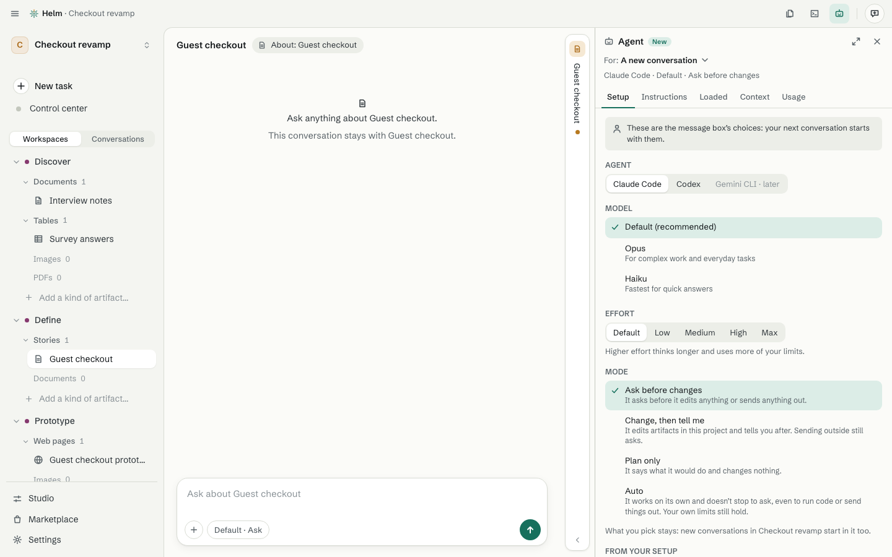

# Working with the agent

[Guide](README.md) · previous: [Artifacts](artifacts.md) · next: [The Studio](studio.md)

Helm works with **Claude Code** and **Codex**, both inside Helm. You sign in with your own account. See [Sign in or switch accounts](../help/sign-in.md).

## Ask

Type in the message box and press Enter (Shift Enter for a new line). Type **/** to see commands: the agent's own, Helm's (Compact, Rewind, Fork, Clear…), and your project's. Each conversation belongs to a place (the project, a workspace or an artifact), like a thread on a document.

Under each reply a quiet line, such as *Claude Code · read 1 file*, opens what the agent had for that answer. The agent's steps show as short rows in its own words ("Read the cart page · 0.1 s"); click one to see what it read or changed. A reply that changed files ends with a sentence ("Changed Checkout v2: 6 lines added, 2 taken out") that opens the before-and-after.

## The Agent pane

The **Agent** button (top right) opens one place for everything about the agent. It follows the conversation you're in.

- **Setup:** which agent (Claude Code or Codex), its **model**, its **effort** (higher thinks longer and uses more of your limits) and **how much it does on its own** (below).
- **Instructions:** notes the agent reads, by where they apply: this conversation, this artifact, its workbench, its workspace, the project, or you everywhere. Each can be switched on or off.
- **Loaded:** everything the agent has right now, grouped, with what each costs in memory.
- **Context:** how full the agent's memory of this conversation is, with **Compact now** to summarise it.
- **Usage:** this conversation's tokens, and your plan's 5-hour and weekly limits.

## How much it does on its own (permissions)

- **Ask before changes** (the default): it asks before it edits or sends anything.
- **Change, then tell me:** it edits artifacts in this project and tells you after. Sending outside still asks.
- **Plan only:** it says what it would do and changes nothing.
- **Auto:** it works without stopping to ask. Helm shows a caution first, and your own limits still hold.

When it needs a yes, a card asks in plain words with **Allow once**, **Always allow** and **No**. *Always allow* means this project, from now on, and appears under **Studio › Permissions**, where you can remove it. Where the rule is the more careful one, the more careful wins.

## Steering a conversation

- **Edit** your message, **Rewind to here** (the conversation, the files, or both), **Fork from here** (a new conversation), **Retry** a reply.
- **Stop** while it works. A message you type meanwhile waits in line, or **Send now** slips it in.
- Helm keeps a copy of the project's files before each message for 30 days, so Rewind can bring files back.

## Reading its work

The agent can do anything you can do on a screen (rename, move, duplicate, change a workbench, set up a routine), each with **Undo**. Removing asks first.
