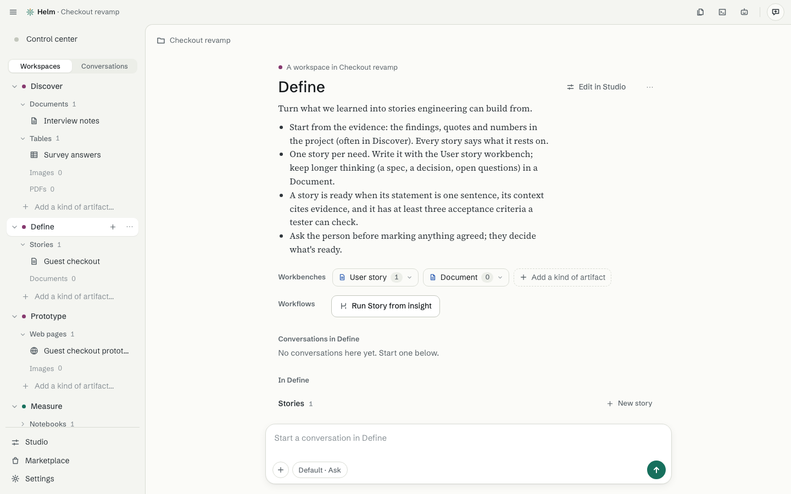

# Workspaces

[Guide](README.md) · previous: [Projects](projects.md) · next: [Workbenches and capabilities](workbenches-and-capabilities.md)

A **workspace** is the place in a project for one job, such as *Discover* (learn from interviews) or *Define*
(write the stories). It holds the workbenches that job needs. It also carries a short **brief**: what the
agents working there should know.

## In the sidebar

The sidebar has two views, switched at the top: **Workspaces** and **Conversations**. In **Workspaces**, each workspace opens to show its artifacts **grouped by kind**: "Stories 3", "Documents 1". Each group folds and opens, and its **+** makes one more of that kind. A kind with nothing yet is one quiet line ("Images 0"); click it to start the first.

**Add a kind of artifact…** at the bottom of a workspace lists the workbenches in your library that this workspace doesn't have yet. Pick one and it adds it and starts the first artifact. The same card has **Make a new kind in the Studio** and **Find one in the Marketplace**.

**New workspace**, under the list, makes a plain one.

## Everyday things

- **Rename:** double-click a name, or press F2. Enter keeps it, Esc cancels.
- **⋯ on a workspace:** Rename, Move up or down (or drag), Colour, Open in Studio, Remove.
- **Remove** always shows you what goes with it and what changes before you confirm, and removed things wait 30 days in **Recently removed**, where **Restore** puts them back.

## The workspace page

Click a workspace's name for its page: the brief, its workbenches (each with **+ New**, **Edit in Studio**), its workflows as buttons, its conversations, and its artifacts. There's a message box at the bottom for a conversation that belongs to this workspace.

## Where do workspaces come from?

Helm comes with **none**. Get them in the [Marketplace](marketplace.md) (for example the Product kit's Discover, Define, Prototype and Measure), or make your own in the [Studio](studio.md). Helm may also add a plain one as you work, and says so with **Undo**.
