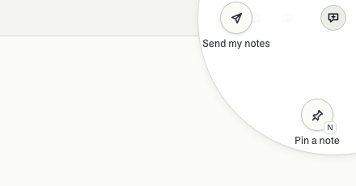

# Report a problem

[Help](README.md)

Use this for anything: something broke, something is confusing, or you have an idea. Your notes go to Heramb
only when you send the file yourself, and you can look at the file first.

## 1. Pin a note on what you saw

1. Click the round **note button** at the top right of Helm, then **Pin a note**. (The keyboard shortcut is **N** when you aren't typing in a box.)

   

2. Click the thing on the screen you mean. A small box opens in the middle of the window.
3. Write what happened, what you expected, or what you'd change. Press **⌘ Enter** on a Mac, or **Ctrl Enter** on Windows and Linux, to pin it.
4. Pin more notes the same way. Helm keeps each one with a picture of the screen at that moment. Press **Esc** or **N** to stop pinning.

## 2. Make the file

1. Click the note button again, then **Send my notes**. (Or **Settings › Data › Gamma › Send my notes…**.)
2. Helm makes one small file called `helm-notes-<day>-<month>.zip` in your **Downloads** folder and tells you its name. Notes you've marked done aren't included.

## 3. Look at what's inside

Open the file (double-click it, or unzip it). It holds:

- `notes.json`: your words, and which screen and part each note is about
- `shots/`: the picture for each note
- `README.txt`: a line saying how many notes and pictures

Nothing else is in it: no project files and no conversations. If a picture shows something private, delete that note and pin it again somewhere else, then make the file again.

## 4. Send it

1. In Helm, open **Settings › Data** and click **Report a problem** (just under **Send my notes**). It opens the
   [problem form](https://github.com/herambskanda/helm/issues/new?template=problem.yml) in your browser.
2. Sign in to GitHub (a free account is enough).
3. Fill in the short form: what happened, what you expected, your computer (Mac, Windows or Linux), your chip (Apple silicon, Intel, x64 or ARM) and Helm's version (**Settings › About**).
4. Drag the `.zip` file onto the form's attach box.
5. Click **Submit new issue**.

No GitHub account? Send the file to Heramb however you usually do.

## What happens next

Heramb reads it, replies on the issue, and fixes what he can in the next version. You'll see a newer Helm
when it's ready: see [Update Helm](update-helm.md).
