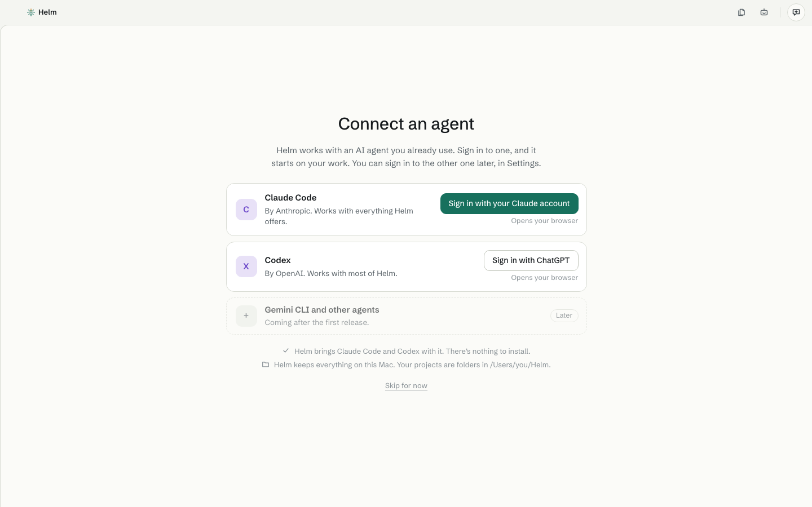

# Install Helm on Linux

[Back to the download table](../../README.md#install) · Mac: [install on a Mac](mac.md) · Windows: [install on Windows](windows.md)

Helm comes two ways: an **AppImage** (one file, runs anywhere, nothing to install) and a **.deb** (for Ubuntu,
Debian and similar). Both exist for x64 and for ARM.

## 1. Which computer type?

Open a terminal and type `uname -m`. *x86_64* means x64. *aarch64* or *arm64* means ARM.

## 2a. The AppImage

1. Download [Helm-linux-x64.AppImage](https://github.com/herambskanda/helm/releases/latest/download/Helm-linux-x64.AppImage)
   (or [Helm-linux-arm64.AppImage](https://github.com/herambskanda/helm/releases/latest/download/Helm-linux-arm64.AppImage)).
2. Make it runnable. In a terminal, in the folder you downloaded it to:

   ```
   chmod +x Helm-linux-x64.AppImage
   ./Helm-linux-x64.AppImage
   ```

   Or right-click the file › **Properties › Permissions** › allow running it as a program, then double-click it.
3. If it says it can't start because of **libfuse2** (common on Ubuntu), install it once:
   - Ubuntu 22.04: `sudo apt install libfuse2`
   - Ubuntu 24.04: `sudo apt install libfuse2t64`

Keep the file somewhere you won't delete it, such as a folder called `Applications` in your home folder.

## 2b. The .deb

1. Download [Helm-linux-x64.deb](https://github.com/herambskanda/helm/releases/latest/download/Helm-linux-x64.deb)
   (or [Helm-linux-arm64.deb](https://github.com/herambskanda/helm/releases/latest/download/Helm-linux-arm64.deb)).
2. In a terminal, in the folder you downloaded it to:

   ```
   sudo apt install ./Helm-linux-x64.deb
   ```

3. Open **Helm** from your applications menu.

## 3. First start

Helm opens on **Connect an agent**. Sign in to Claude Code (with your Claude account) or Codex (with ChatGPT).
Your browser opens to sign in, and you come back to Helm. See [Sign in or switch accounts](../help/sign-in.md).



The first time, Helm also shows a short note called **Helm is in gamma**. It says what is shared and how to
switch it off. Press **Got it**. Then go to [Get started](../guide/getting-started.md).

In Helm, **Ctrl** is the key to use where the guide says ⌘ on a Mac.

## Where Helm keeps things

| What | Where |
|---|---|
| Your projects | A folder called **Helm** in your home folder (`/home/<you>/Helm`). Each project is a folder inside it. You can choose another place in **Settings › Appearance › New projects**. |
| Helm's own things (settings, your library, your notes) | `/home/<you>/.helm` (hidden; Ctrl H shows hidden folders in most file managers) |
| Window size and position | `~/.config/Helm` |

After you close the window Helm stays in the **tray** if your desktop has one (some desktops, such as plain
GNOME, need a tray extension), so routines can keep running. **Quit Helm** from the tray menu really quits.

## Updating

When a newer Helm is out, Helm says **A new Helm is ready · Download**. Click it and download the new file.
AppImage: replace the old file with the new one. .deb: run the same `sudo apt install ./Helm-linux-x64.deb`
again with the new file. Your projects stay as they are. See [Update Helm](../help/update-helm.md).

## Uninstalling

Quit Helm, then:

- AppImage: delete the file.
- .deb: `sudo apt remove helm`.

Your projects in `~/Helm` and Helm's own folder `~/.helm` stay behind on purpose. To remove everything, see
[Uninstall Helm](../help/uninstall.md).

Having trouble? [Helm won't open](../help/wont-open.md).
